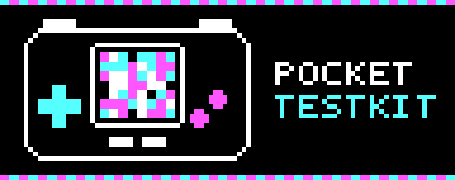
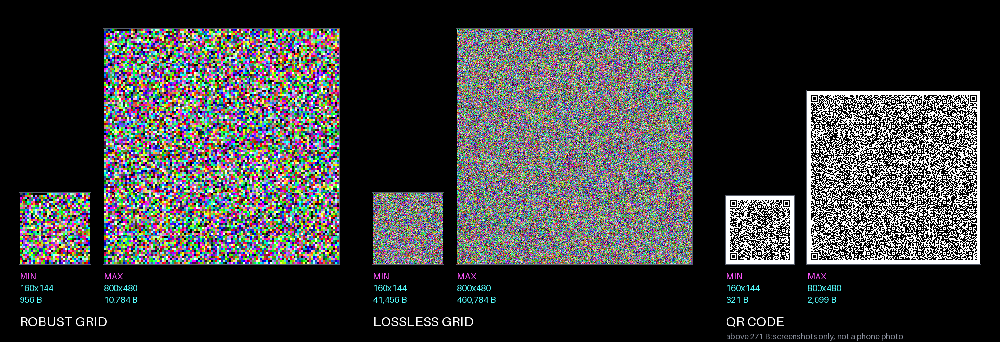

<p align="center"></p>

# pocket-testkit

A toolkit and a field guide for **testing Analogue Pocket cores** (and other small hardware or firmware projects), built for work with an AI agent. It organises the testing methods from cheap file checks to the device, says what each one finds, what it costs and how to choose, and ships tools, RTL and templates you can reuse.

Extracted from the Tau project for the Analogue Pocket. Apache-2.0.

## Contents at a glance

```
pocket-testkit/
├── docs/            concepts: methodology, choosing a method, AI workflow, Pocket notes, reviews
├── methods/         one folder per testing method (what, when, pros/cons, code, tests)
│   ├── file-checks/      JSON limits, stale-bitstream check
│   ├── host-tests/       reference models, golden vectors, mutation, coverage
│   ├── fuzzing/          parsers under sanitizers
│   ├── formal/           proofs for small control logic
│   ├── simulation/       RTL, whole-core with a Pocket host model
│   ├── timing-fit/       map gate, block fits, full fit, seeds
│   ├── report-codes/     results out of a device as a picture (grid, QR)      [code, sample Pocket core]
│   ├── debug-links/      JTAG and serial: live registers, memory, signals     [RTL]
│   ├── pocket-native/    the Pocket's own debug log, event log, pause options
│   └── ci/               continuous integration
├── starter/         a Claude project starter: CLAUDE.md, rules, status files, test ladder, checks
├── agent/           rules to paste into an AI agent's instructions
└── assets/          logo
```

## The methods

Ordered by when they pay off. Full catalogue: [methods/](methods/README.md).

| Phase | Method | Answers | Cost | In this kit |
|---|---|---|---|---|
| Check before you build | [File checks](methods/file-checks/README.md) | Are the JSON and package files right? | seconds | tools + tests |
| | [Host tests](methods/host-tests/README.md) | Is the algorithm, format or parser right? | low | used throughout |
| | [Fuzzing](methods/fuzzing/README.md) | Does a parser survive any input? | low | guide |
| | [Formal](methods/formal/README.md) | Can this control logic never overflow or deadlock? | medium | guide |
| Simulate | [Simulation](methods/simulation/README.md) | Does the RTL, or the whole core, behave? | minutes to an hour | link-RTL testbenches |
| Build gates | [Timing and fit](methods/timing-fit/README.md) | Does it meet timing and fit? | minutes to hours | guide |
| Observe on the device | [Report codes](methods/report-codes/README.md) | What did the device do, from anyone, with no cable? | none | **code, tests, real-device use** |
| | [Debug links](methods/debug-links/README.md) | What are the live registers, memory, signals? | cable and a build | RTL, simulated only |
| | [Pocket's own tools](methods/pocket-native/README.md) | Why does it fail to boot or load? | none | guide |
| Process | [CI](methods/ci/README.md) | Did something break that nobody re-ran? | low | one workflow |

"Guide" = described with trade-offs and references, no code. Nothing here has been run on a Pocket except the report codes.



*Report codes: a lossless grid, a robust grid and a QR code, pixel-exact at two screen sizes.*

## How to choose

Start from the question ([full guide](docs/choosing.md)):

| I need to know... | Use |
|---|---|
| whether my files and package are right | file checks |
| whether my code or format is right | host tests, then fuzzing for parsers |
| whether my RTL works, or my core boots | simulation |
| whether it meets timing | timing and fit gates |
| what the device did, from a tester or away from my desk | **report codes** |
| the live registers or signals, at my desk | a debug link ([which one](methods/debug-links/CHOOSING.md)) |
| why it fails to boot or load | the Pocket's own tools |

Prefer the method that answers earliest on the ladder; do both a link (to find a bug) and a report code (to prove the fix on the shipped build) when you can.

## Guides

| Guide | Read it for |
|---|---|
| [Methodology](docs/methodology.md) | The ladder, evidence labels, independent oracle, one verdict, one device trip |
| [Choosing a method](docs/choosing.md) | By question or situation |
| [AI workflow](docs/ai-workflow.md) | Using an AI agent efficiently, mistakes to turn into checks |
| [Pocket notes](docs/pocket-notes.md) | Boot order, what a host model must exercise, link port, fit rules |
| [Testing audit](docs/reviews/testing-audit-2026-11.md) | The review against Analogue's docs and the knowledge base |
| [Documentation index](docs/README.md) | Everything, by level |

## Start a project

[`starter/`](starter/README.md) has a `CLAUDE.md`, rules (evidence labels, test ladder, mutation, long jobs, card writes, worktrees), status, roadmap, audit-trail and decision files, a test ladder (`ladder.json`) with one runner (`verdict.py`) that cannot claim more than was run, the file checks, an example settings file and a skill. Copy and adapt.

## Run the tests

Each method keeps its tests in its own folder; run them from there.

| Folder | Command | Needs |
|---|---|---|
| `methods/report-codes` | `python3 tests/test_tpg_resolutions.py`, `test_tpg_c.py`, `test_decode_and_density.py`, `test_qr.py`, `test_pocket_meta.py`, `test_sample.py`, `core/tests/test_core_sim.py`, `core/tests/test_core_files.py`; `cargo test --features cli` in `rust/` | `pip install numpy pillow opencv-python segno`, a C compiler, Rust, iverilog (core simulation) |
| `methods/debug-links` | `python3 tests/test_debug_link.py` | iverilog |
| `starter` | `python3 tests/test_templates.py` | nothing |

## Evidence status

| Part | Evidence |
|---|---|
| Report codes | Grids and QR decode from real Pocket screenshots of Tau cores; Python and Rust decoders agree on 31 real captures; owner's real phone photos of QR pages exist but are not recorded here, so the photo limits and example photos are simulated; other screen sizes host-tested only; Rust crate in CI on Linux, macOS, Windows, WebAssembly |
| Debug-link RTL, sample-pages Pocket core | iverilog simulations and mutation checks; **never compiled with Quartus or run on a Pocket** |
| File checks, starter tools | host tests |
| Guides | reviewed against Analogue's docs and a knowledge base; items marked unverified need a test on your setup |

## Licence

Apache License 2.0 ([LICENSE](LICENSE), [NOTICE](NOTICE)). The grid codec and QR encoder were written for Tau by the same author and are relicensed here. No copyleft code is included.
