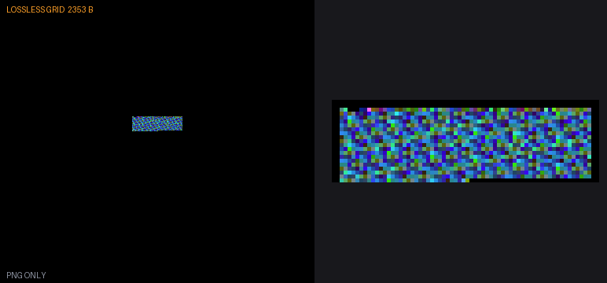
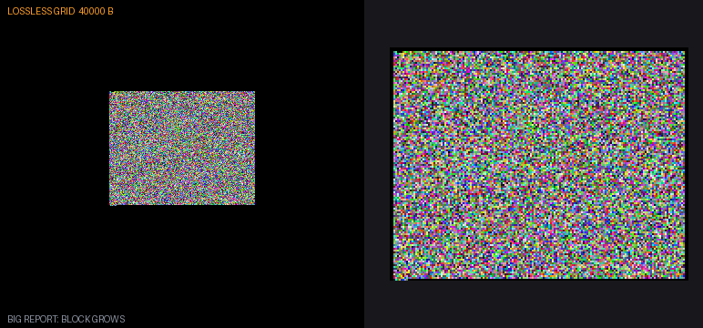
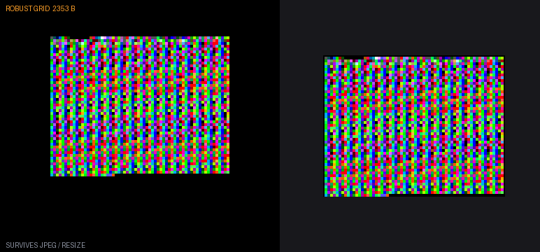
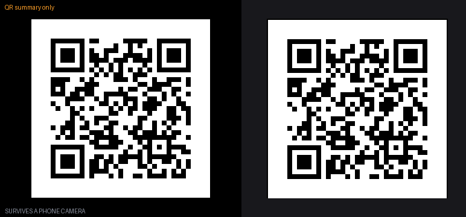
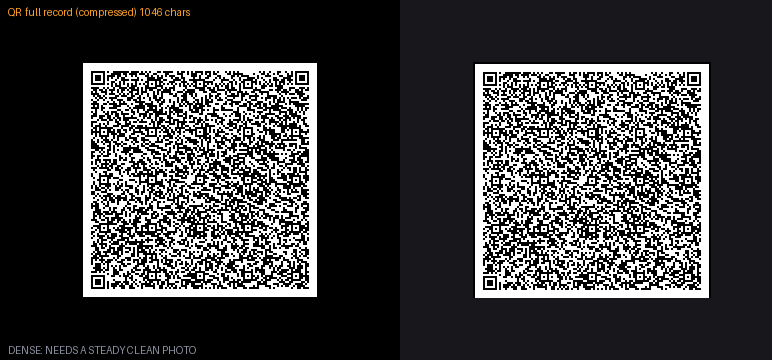
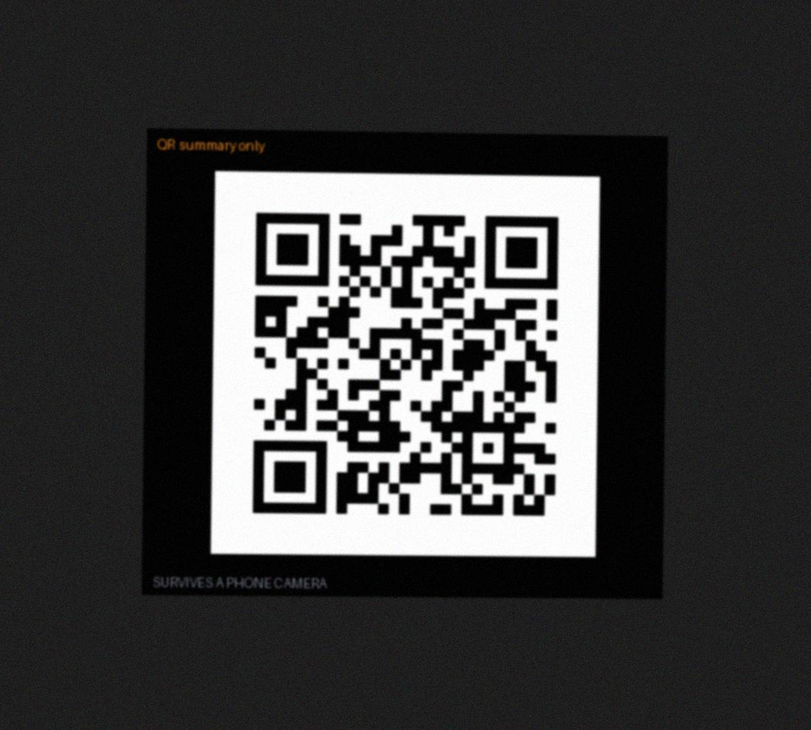
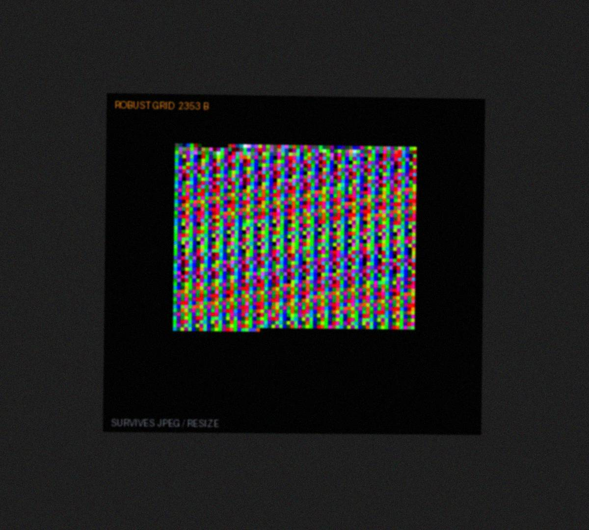

# pcket-testkit

Carry test and diagnostic results **out of a device as a picture**, and decode them on a PC.
Built for the Analogue Pocket (400x360 screen, screenshots are lossless), extracted from the Tau project's report codes.

One payload, one CRC32, **three carriers**. Pick by how the picture leaves the device:

| Tier | Carrier | Capacity | Survives | Use when |
|---|---|---|---|---|
| **L** | Lossless colour grid | ~259 KB | lossless PNG only | You copy the screenshot file off the device |
| **R** | Robust colour grid | ~6 KB | JPEG q80+, chat resize | The screenshot goes through chat or email |
| **Q** | QR code (Tau's own encoder, level L, versions 1-38) | ~2.7 KB text; small versions for photos | a phone camera (small versions); screenshots (dense) | An **external photo** of the screen, or any scanner app |

A bad decode fails loudly (CRC32), never silently.

> Status: **early extraction.** Both carriers are Tau's own code, which ran on a Pocket: the grid codec (`python/tpg.py`, `c/tpg.h`, decoded from Pocket screenshots through DEV 219) and the QR encoder (`c/qr/`, the one the Tau report pages used before the grid; restored from git history). Here the QR encoder is checked against the `segno` reference for all 38 versions, not on a Pocket. The "photo" pictures below are a **simulation**, not a real camera.

## The examples

Every picture is generated by `python3 examples/make_examples.py` from one sample report (2,352 bytes of JSON-like text). Left: the 400x360 screen as the Pocket would show it. Right: the code enlarged.

### Tier L: lossless grid
One RGB565 pixel carries 16 bits. Smallest possible picture for a given report, but any lossy step destroys it.



A large report (40,000 bytes) just grows the block:



### Tier R: robust grid
4x4-pixel cells, two bits per colour channel. Decoded correctly after JPEG quality 80 (checked by the example script).



### Tier Q: QR code
For a camera or any scanner app. A small code carries a short summary (verdict, run counter, build, CRC of the full record). The encoder is the Pocket firmware's own (`c/qr/qrcode.h`).



A dense code carries the whole record (here zlib + base64url, 1,046 characters, version 23, 2 px modules). It decodes from a screenshot with the Aruco detector in `python/qr_decode.py`; Tau found dense codes are harder for a phone, so keep photo codes small.



### Simulated phone photos (tilt, blur, noise, JPEG q70)

QR decodes; the colour grid does not, which is why tier Q exists. Results in [`docs/img/RESULTS.txt`](docs/img/RESULTS.txt).

| QR, simulated photo (decoded) | Robust grid, simulated photo (not decoded) |
|---|---|
|  |  |

## Use it

```bash
pip install numpy pillow opencv-python
python3 python/tpg.py encode report.bin shot.png --mode R     # make a picture
python3 python/tpg.py decode shot.png report.bin              # read it back (exit 1 = invalid)
python3 python/qr_decode.py                                   # (library) decode a QR from a screenshot or photo: qr_decode.decode(path)
python3 tests/test_qr.py                                      # QR encoder vs segno, all versions (needs: pip install segno)
python3 examples/make_examples.py                             # regenerate the pictures above
```

`c/qr/qrcode.h` is portable C (no libc, no malloc, caller-supplied working buffer, level L, byte mode, versions 1-38); `python/qr_tier.py` builds it natively and draws it. On a device, `c/tpg.h` is the pure C core (where the block sits and which value pixel (x, y) has); the C and Python codecs match pixel for pixel in Tau's tests.

## Format (TPG2)

16-byte header: `TPG2`, mode (0 = L, 1 = R), flags, reserved, payload length (u32 BE), CRC32 of the payload. Then the payload, zero padded, in a square block centred on the screen whose side comes from a fixed ladder. Full detail in the `python/tpg.py` docstring.

## Not yet done

Spec file with golden vectors; Reed-Solomon for tier R; multi-QR for full reports through a camera; Rust and web decoders; the grid tests in this repo (they live in Tau: `sim/test_tpg.py`, `sim/test_tpg_fw.py`); a recorded phone-photo trial with real photos (the simulation here is not one).

## Licence and provenance

MIT. The grid codec and the QR encoder were written for the Tau project (itself MIT); the QR encoder follows ISO/IEC 18004 with structure after Nayuki's reference layout, per its own header. No copyleft code is included; the colour-code alternative JAB was assessed and left out.
