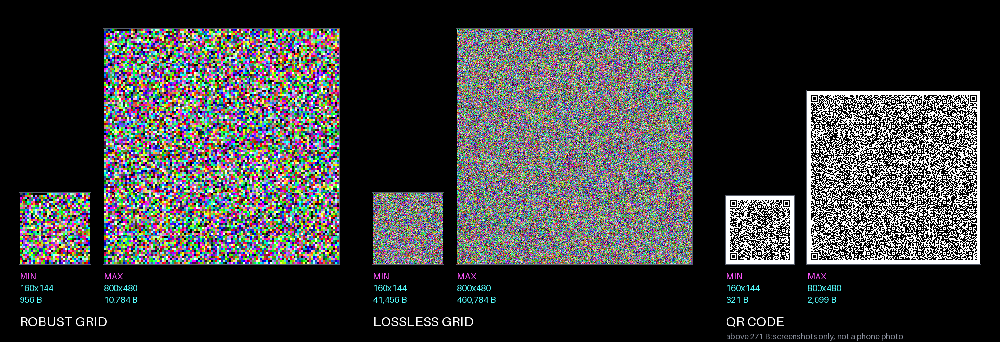
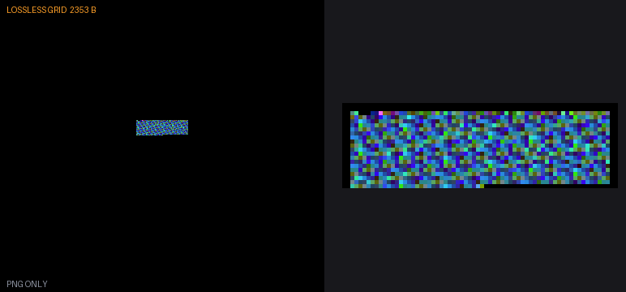
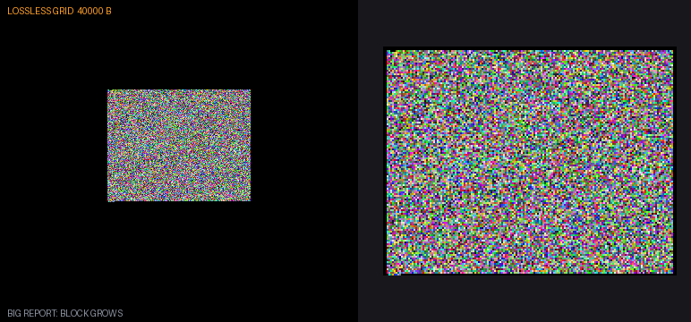
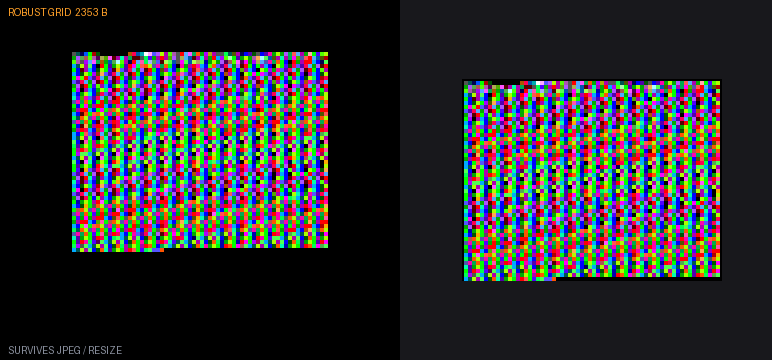
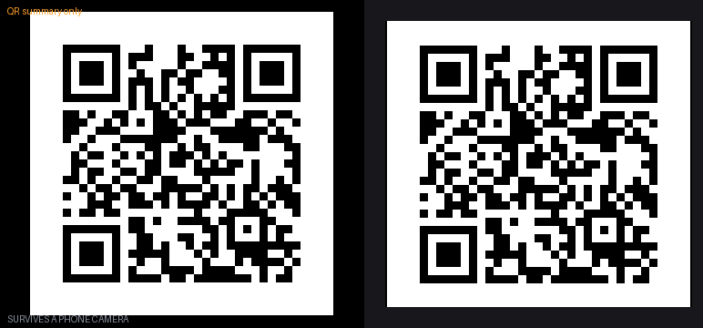
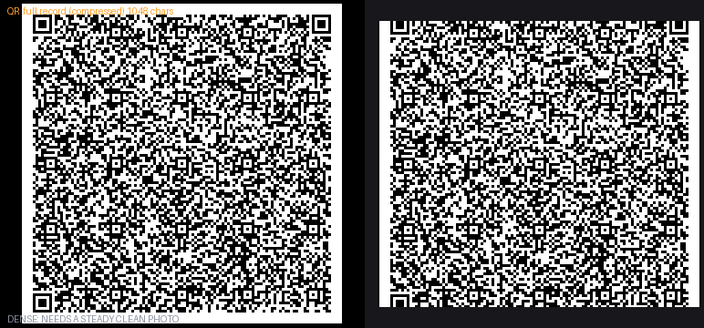
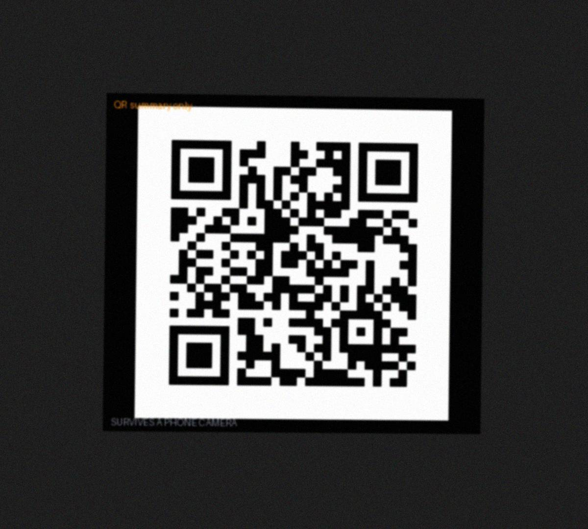
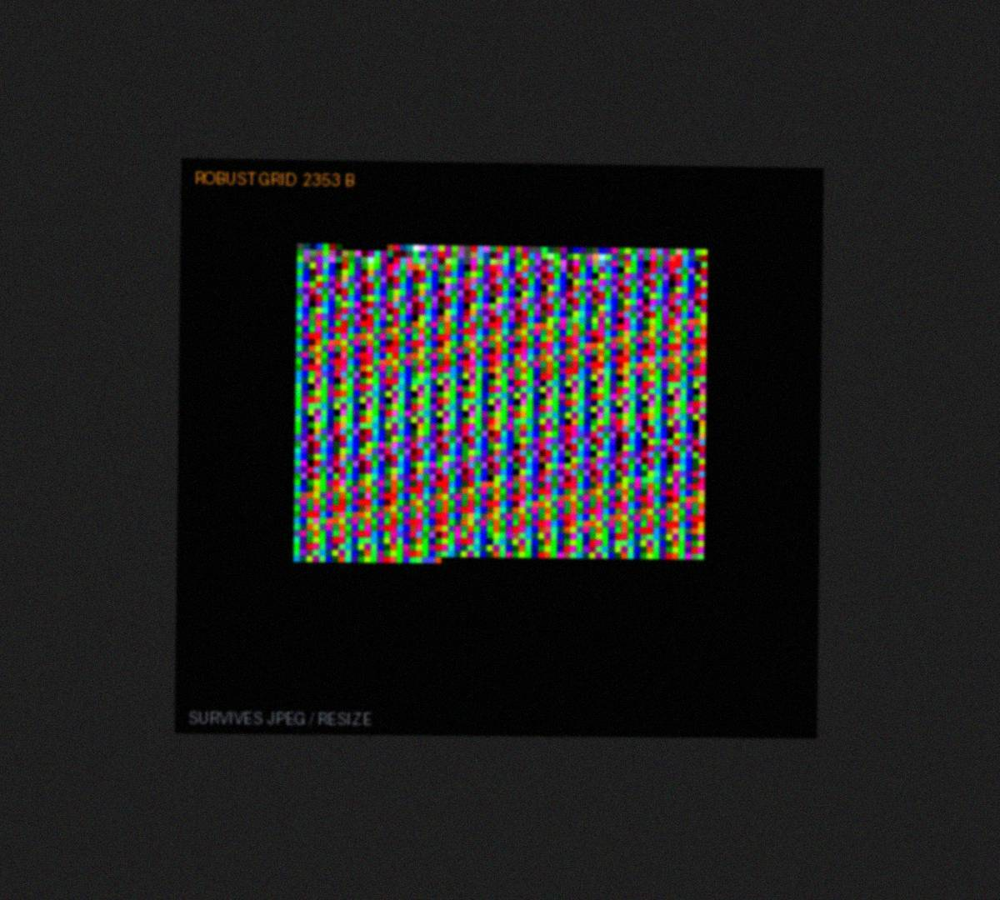

# Report codes: results out of a device as a picture

**Phase:** observe on the device · **Cost:** no cable, no network · **Status in this kit:** code and host tests; used on real Pocket screenshots and photos (see Status)



## What it does
The firmware draws its test or diagnostic results as a **coloured pixel grid** or a **QR code** on its own screen. A screenshot or a phone photo is the transport; a PC decodes it, checks a CRC32 and returns the payload. Works on any screen size.

## Use it when
- a **third party** (a tester, a user) has to send you data and has no cable;
- you want to measure **the shipped build**, not an instrumented one;
- you want a record **archived next to the build**, with the core name and version added by the Pocket ([SCREENSHOT_METADATA](docs/SCREENSHOT_METADATA.md));
- the screenshot should also show the page and state.

Prefer a [debug link](../debug-links/README.md) at a desk when you need live or high-rate data.

## Pros and cons
| Pros | Cons |
|---|---|
| No cable, no extra build, anyone can produce it | A person takes the picture; one-way and not live |
| Large payloads in one shot (259 KB lossless at 400x360) | Camera photos only carry small QR codes: dense colour grids do not survive a camera |
| Integrity checked: a damaged picture fails loudly, never decodes to a wrong value | Density limits for photos are simulated; real photos would be better fixtures |

## Pick a carrier

One payload and one CRC32, three ways to draw it. Choose by how the picture leaves the device.

| Tier | Carrier | Survives | Use when | Capacity |
|---|---|---|---|---|
| **L** | Lossless colour grid | a lossless PNG only | you copy the screenshot file off | table below (most) |
| **R** | Robust colour grid | JPEG q80+, chat resize | the screenshot goes through chat or email | table below |
| **Q** | QR code | a phone photo (small codes), any scanner app | an **external photo** of the screen | 271 B (photo) to 2,699 B (screenshot only) |

A damaged picture fails loudly on the CRC32; it is never decoded to a wrong payload.

## Capacity by screen size

The grid keeps the same pixel size on every screen (1 px per 16 bits for L, 4 px cells for R), so a bigger screen holds more. Payload bytes, header already deducted. Rows are resolutions a Pocket core realistically runs at (for reference: 160x144 Game Boy, 240x160 Game Boy Advance, 256x224 NES/SNES, 400x360 what Tau uses, 800x720 the Pocket's maximum).

| Resolution | Grid L, lossless | Grid R, robust (4 px cells) | QR safe max (photo) | QR largest that fits |
|---|---|---|---|---|
| 160x144 | 41,456 | 956 | 271 (2 px) | 321 (v11) |
| 240x160 | 51,184 | 1,184 | 271 (2 px) | 425 (v13) |
| 256x224 | 100,336 | 2,336 | 271 (3 px) | 929 (v21) |
| 320x240 | 115,184 | 2,684 | 271 (3 px) | 1,091 (v23) |
| 400x360 | 259,184 | 6,059 | 271 (5 px) | 2,699 (v38) |
| 640x480 | 460,784 | 10,784 | 271 (7 px) | 2,699 (v38) |
| 800x480 | 460,784 | 10,784 | 271 (7 px) | 2,699 (v38) |
| 800x720 | 1,036,784 | 24,284 | 271 (11 px) | 2,699 (v38) |

The table stops at 800x720, the largest video size the Pocket's core interface accepts (16x16 to 800x720 in Analogue's developer docs; not re-tested on hardware here). The codec has no such limit: it was tested up to 4K for other devices, see [docs/RESOLUTIONS.md](docs/RESOLUTIONS.md).

**QR columns.** The *safe max* is the `photo` level (version 10, 271 bytes), the most a phone scanner is expected to read; in brackets the module size it is drawn with on that screen (the biggest whole-pixel size that fits). *Largest that fits* is the densest code the screen can draw with at least 2 px modules (version in brackets); anything above 271 bytes is for screenshots only. QR capacity is set by the QR version, not the screen, so a bigger screen only draws the same code bigger. Module size matters for photos: below 3 px, test with a real photo (the density study did not cover small screens).

| QR density level | Version | Bytes | Meant for |
|---|---|---|---|
| `photo` (default) | 1-10 | 271 | a phone scanner |
| `careful` | 11-22 | 1,003 | a steady, close, sharp photo (warns) |
| `max` | 23-38 | 2,699 | screenshots only; refused unless confirmed |

Why these limits, and the simulated-photo results behind them: [docs/DENSITY.md](docs/DENSITY.md). A robust grid with 8 px cells holds about a quarter of the R column and survives harsher scaling ([docs/RESOLUTIONS.md](docs/RESOLUTIONS.md)).

## Quick start

```bash
pip install numpy pillow opencv-python

python3 python/tpg.py encode report.bin shot.png --mode R --size 1280x720   # draw a grid for any screen
python3 python/qr_tier.py "PKT1 PASS run=17" qr.png                         # draw a QR (density photo)
python3 python/decode.py shot.png                                           # read any tier; --json, --out file
```

Rust: `cargo run --features cli --bin pocket-decode -- shot.png` in `rust/`. On a device, copy `c/tpg.h` and `c/qr/`. Full wiring, by hand or with an AI coding agent: [docs/INTEGRATION.md](docs/INTEGRATION.md).

## What the pictures look like

Left: the 400x360 screen as drawn on the device. Right: the code enlarged. Regenerate with `python3 examples/make_examples.py`.

**L, lossless grid** (2,352-byte sample report; a 40,000-byte report just grows the block)




**R, robust grid** (decodes after JPEG q80)



**Q, QR code**: a small summary code (photo level), and a dense one carrying the whole record (version 23, 2 px modules, screenshot only)




**Simulated phone photos** (tilt, blur, noise, JPEG q70): the QR decodes, the colour grid does not. That is why tier Q exists.

| QR | Robust grid |
|---|---|
|  |  |

**Pocket screenshots also say which core made them.** The Pocket appends the core's author, name and version to the PNG (after its last chunk), so you can identify a report's source without putting it in the payload: [docs/SCREENSHOT_METADATA.md](docs/SCREENSHOT_METADATA.md).


## Format (TPG2)

A 16-byte header (`TPG2`, mode, flags, reserved, payload length, CRC32; big endian), then the payload, in a square block centred on the screen. The block side comes from a ladder that depends only on the screen's short side; flag byte 5 holds the robust cell size when it is not 4. At 400x360 the output is byte-identical to the original Pocket format (`tests/golden_400x360.json`). Details: the docstring in `python/tpg.py`.

## Status

| | Evidence |
|---|---|
| Grid on a real Pocket | Tau screenshots from its test cores decode; the Python and Rust decoders agree on all 31 real captures of Tau Omega's test data |
| QR on a real Pocket | decoded from real screenshots, up to a 2,281-byte dense code; the encoder also matches `segno` for all 38 versions |
| Rust crate | tests pass in CI on Linux, macOS and Windows; the core and QR build for WebAssembly |
| Other screen sizes | host tests only (13 sizes, Python and C equal pixel for pixel) |
| Phone photos | used in practice: the owner photographed Tau Alpha's QR pages with a phone. Those photos and their results are **not recorded in this repo**, so the density limits and the example photos here are simulated |

The sample pages are host-tested only, never run on a Pocket. Not done: recording the real phone photos as test pictures (to replace the simulated density limits), error correction for tier R, multi-QR for full reports through a camera, a web decoder, a Quartus build and Pocket run of the sample-pages core, fuzzing the decoders.


## Documentation
| Doc | Topic |
|---|---|
| [INTEGRATION](docs/INTEGRATION.md) | Wire it into a project, by hand or with an AI agent; verification; traps |
| [DENSITY](docs/DENSITY.md), [qr_density](docs/qr_density.md) | QR density levels and the study behind them |
| [RESOLUTIONS](docs/RESOLUTIONS.md) | Screen sizes, the size ladder, harsher scaling |
| [SCREENSHOT_METADATA](docs/SCREENSHOT_METADATA.md) | The core info the Pocket appends to screenshots |
| [SAMPLE_PAGES](docs/SAMPLE_PAGES.md) | Nine sample pages for every carrier at typical sizes and limits |

## Code
| Path | What |
|---|---|
| `python/` | `decode.py` (any tier), `pocket_meta.py`, `tpg.py` (grid), `qr_tier.py`, `qr_decode.py` |
| `c/` | `tpg.h` (grid core), `qr/` (QR encoder, versions 1-38, no libc, no malloc), `sample/` (sample pages) |
| `rust/` | OS-independent decoder crate ([README](rust/README.md)) |
| `examples/` | picture and gallery generators |
| `tests/` | all tests and the density study |
| `core/` | [Sample-pages Pocket core](core/README.md): RTL, JSON, assembler, simulation tests (not yet built with Quartus) |
| `tools/` | QR table generator |

Tests (from this folder): `python3 tests/test_tpg_resolutions.py`, `test_tpg_c.py`, `test_decode_and_density.py`, `test_qr.py` (needs `pip install segno`), `test_pocket_meta.py`, `test_sample.py`, `core/tests/test_core_sim.py`, `core/tests/test_core_files.py`, and `cargo test --features cli` in `rust/`. Needs `pip install numpy pillow opencv-python`.

